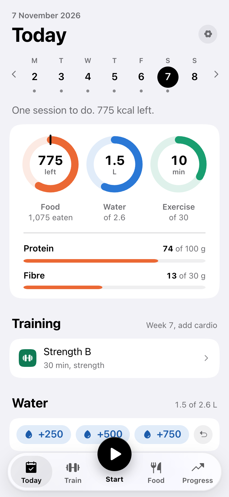
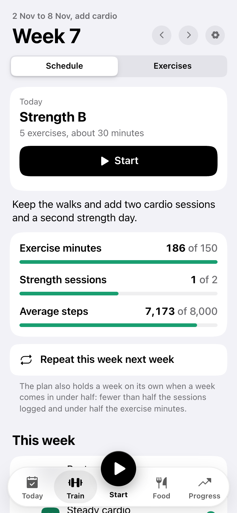
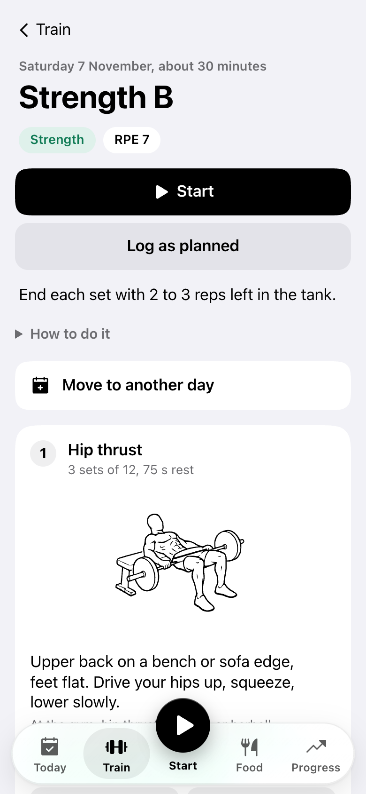
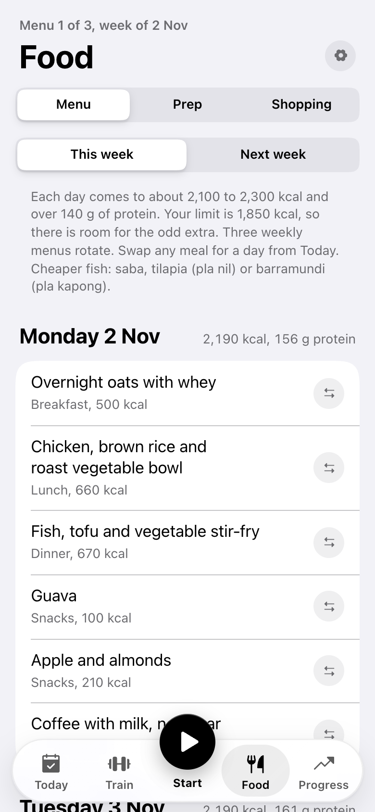
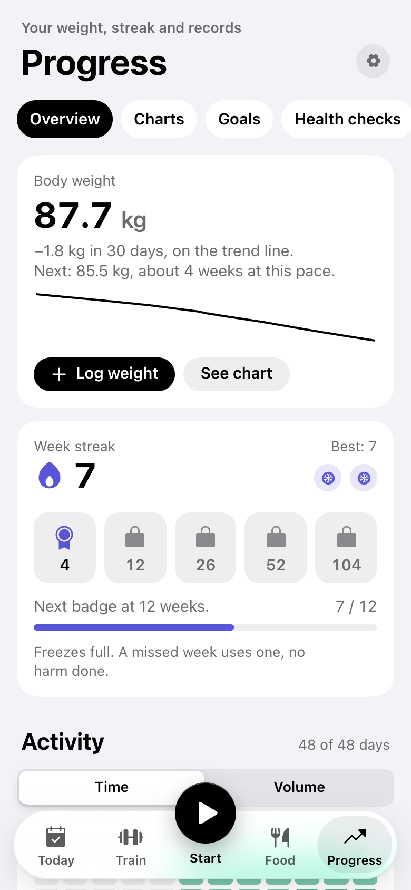
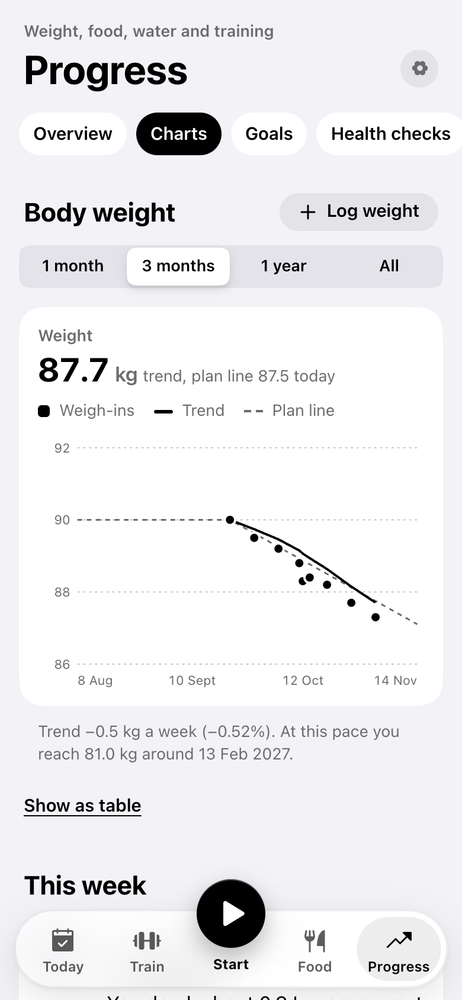
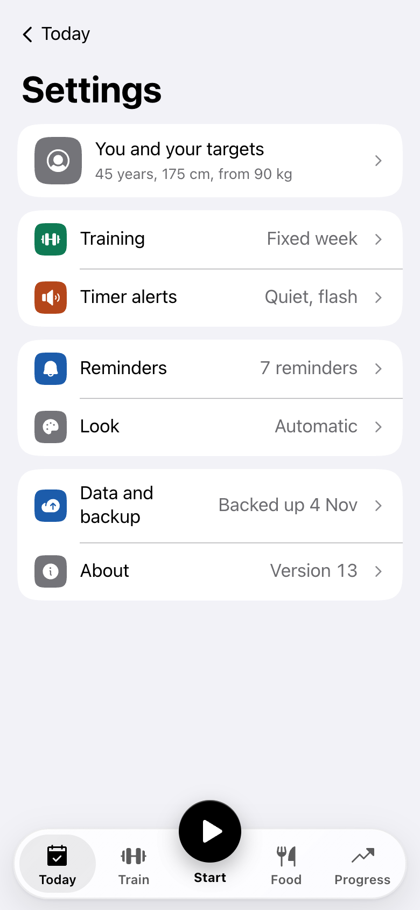
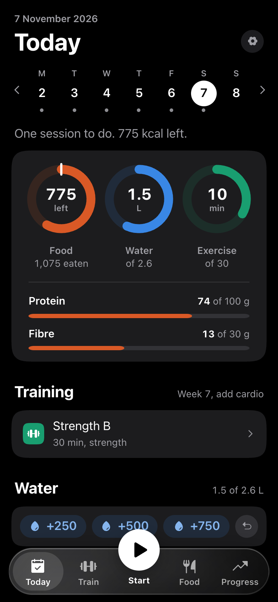

# Steady

Steady is an offline iPhone web app for losing weight slowly and getting fitter: a training plan that starts from walking, a weekly menu with recipes and a shopping list, and logs for food, water, workouts and weight. Everything stays on the phone.

Live at <https://ramidzpower.github.io/steady/>.

<table>
  <tr>
    <td></td>
    <td></td>
    <td></td>
    <td></td>
  </tr>
  <tr>
    <td></td>
    <td></td>
    <td></td>
    <td></td>
  </tr>
</table>

The screenshots use invented demo data from `tools/demo-state.mjs`.

## What it does

- **Today** shows calories left, water and exercise minutes as rings, then the day's session, water buttons and meals. Swipe a meal left to swap it.
- **Train** runs 12-week blocks with heart-rate and effort targets. Sessions can move to another day, and strength sessions log weight and reps, with a rest timer. There is an exercise library with drawings, and you can add your own exercises.
- **Food** has three rotating weekly menus, a prep plan for Sunday and Wednesday, a shopping list built from the week, recipes, and a guide to eating out in Bangkok.
- **Progress** shows the weight trend and the next milestone, a week streak, an activity grid, recent workouts and charts for food, water, training and VO2max. Health checks keeps blood tests, blood pressure and waist, and can share a one-page PDF for your doctor.
- **Settings** sits behind the gear on each tab: your targets, training mode, timer alerts, calendar reminders, light or dark theme, backups and Watch imports.

The big Start button in the tab bar opens today's next session, or the one that is running.

## Your data

There is no server and no account. The app keeps everything in the browser storage of the phone it runs on. Backups are JSON files you export yourself, and you can lock one with a passcode (AES-GCM). Watch numbers come in through an iPhone Shortcut or an import file; the steps are in Settings, Data and backup.

This repository holds no personal data. The test fixtures and the demo state are made up.

## Install on an iPhone

Open the live link in Safari, tap Share, then Add to Home Screen. After the first visit the service worker caches the app, so it opens without a connection.

## Develop

Plain JavaScript modules, no build step and no dependencies.

```sh
# from the repo
python3 -I -m http.server 8765 --bind 127.0.0.1   # then open http://127.0.0.1:8765/
npm test                                           # same as node --test tests/
```

To release, add an entry to `CHANGES` and raise `APP_VERSION` in `plan.js`, then raise `VERSION` in `sw.js`. Phones keep the old files until `VERSION` changes. GitHub Pages serves `main`.

`tools/` has the browser checks (sideways overflow, tap target size, the sheet's drag physics), the icon builder and the demo state; [tools/README.md](tools/README.md) explains them. `zsh tools/readme-shots.sh` takes the screenshots above again and needs [agent-browser](https://github.com/vercel-labs/agent-browser).

## Credits

- Icons: [Phosphor Icons](https://phosphoricons.com) 2.1.1, MIT licence (`icons/PHOSPHOR-LICENSE.txt`).
- Exercise drawings: Workout Guide by Bryl Lim, some traced from Everkinetic, CC BY-SA 4.0. Full credits are in `img/ex/LICENSE.txt`.
- Thai dish values: the Thai Food Composition Database (INMU, Mahidol University, 2025), the Thai Department of Health food tables (2008 and 2018) and a Bangkok delivery food study (IJERPH, 2023).

Steady is a personal tool, not medical advice. Settings, About lists the signs that mean stop and get medical help.
